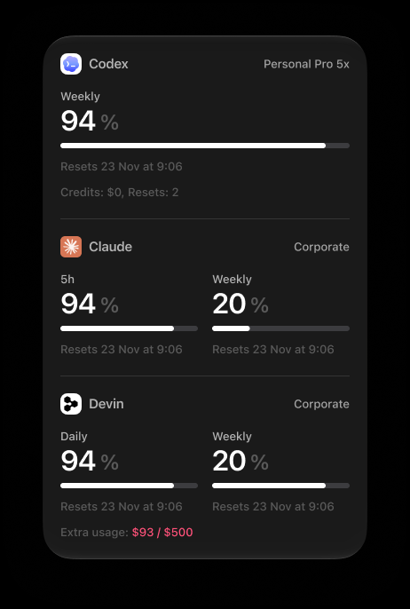

# Mini Token Bar

A tiny native macOS menu-bar app showing your Codex, Claude, and Devin usage limits at a glance — three percentages, one bar.

<p align="center"></p>

## Install

Copy this prompt into any AI coding agent running on your Mac (Codex, Claude Code, Cursor, etc.):

```text
Install MiniTokenBar from https://github.com/sanekovs/minitokenbar on this Mac. Read INSTALL.md and follow it: check prerequisites, clone the repo, build, install, launch, and verify the app is running. Never print or upload my credentials.
```

Or install it yourself:

```sh
git clone https://github.com/sanekovs/minitokenbar.git
cd minitokenbar
./scripts/install.sh
```
